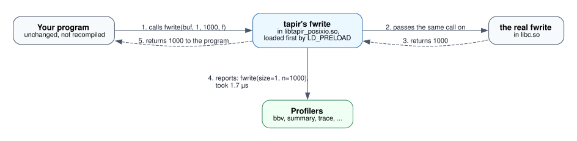

# 1. Intercepting calls

This chapter explains how tapir sees a program's calls at all. It
introduces four terms: **shared library**, **wrapper**, **wrapper
library**, and **runtime**.

## Shared libraries and the dynamic linker

Most programs don't contain the code for `fwrite`, `cublasDgemm` or
`MPI_Send`. That code lives in **shared libraries**: files such as
`libc.so`, `libcublas.so` or `libmpi.so`. When the program starts, a part
of Linux called the **dynamic linker** loads those libraries and connects
each function name the program uses (`fwrite`) to the library that defines
it (`libc.so`).

Normally only one library defines each name. But the dynamic linker
accepts an extra library through the `LD_PRELOAD` environment variable,
loads it *before* all the others, and uses its definitions first:

```sh
LD_PRELOAD=/path/to/extra.so ./program
```

If `extra.so` defines a function named `fwrite`, the program's calls to
`fwrite` go to `extra.so`, not to libc. The program is not modified in any
way. This technique is called **interposition**, and it is the "I" in
tapir.

## Wrappers

A **wrapper** is a function with the same name and the same parameters
as the function it replaces. tapir's wrapper for `fwrite` does three
things:

1. finds the *real* `fwrite` (the next definition after its own) and
   calls it with exactly the same arguments,
2. measures how long that took and notes the arguments,
3. returns the real function's result to the program.

The program gets the same result it would have gotten anyway. The only
difference is that tapir now knows the call happened.



Step 4 mentions *profilers*. For now, think of them as "the code that
receives the recorded calls". They are explained in
[chapter 3](profilers.md).

## The wrapper library

You don't write wrappers one at a time as separate files. All the wrappers
for one C library go into one **wrapper library**: a shared library (`.so`)
built from a small Rust crate. You put it in `LD_PRELOAD` when you run the
program.

| Wrapper library | Wraps | Comes with tapir? |
|---|---|---|
| `libtapir_posixio.so` | a few C standard library functions (`fopen`, `fwrite`, `qsort`, ...) | yes, as an example |
| `libtapir_cuda.so` | cuBLAS, cuSOLVER, cuSPARSE and the CUDA runtime | yes |
| `libtapir_rocm.so` | rocBLAS, rocSOLVER, hipBLAS, hipSOLVER, rocSPARSE and the HIP runtime | yes |
| `libtapir_pix.so` | the tutorial's `pix` library | you build it in the tutorial |

## Which functions get wrapped

tapir never decides this on its own at run time. **A function is wrapped
if, and only if, the wrapper library contains a wrapper for it.** That is
fixed when the wrapper library is built. Every other function goes
straight to the real library, untouched and at no cost.

Who decides depends on how the wrapper library was made.

**Written by hand.** Inside the Rust crate, wrappers are declared with a
macro called `interpose!`, one line per function. The functions listed
there are wrapped and nothing else is. For example, `libtapir_posixio.so`
lists exactly `fopen`, `fclose`, `fread`, `fwrite` and `qsort`, so
`fprintf` or `fseek` calls are not recorded.

**Generated from a header.** A tool called `tapir-gen` reads the library's
C header and writes the `interpose!` lines for you. It decides in four
steps:

1. **Take every function declared in the header**, or only those marked
   with the library's export macro, if you give one (`CUBLASAPI`,
   `ROCBLAS_EXPORT`).
2. **Apply name filters** set by whoever builds the wrapper library:
   *exclude* patterns remove functions (`*Create*`, `*_get_*`), and
   *include* patterns, if any are given, keep only matching functions.
3. **Drop what cannot be wrapped safely.** This includes functions with a
   parameter type `tapir-gen` doesn't know the size of, functions with a
   variable argument list (like `printf`), and functions that take a
   struct by value. tapir-gen never guesses about these.
4. **Write a report** listing every function that was skipped, and why.

**The GPU wrapper libraries** use `tapir-gen` on the headers installed on
your machine, so they match your CUDA or ROCm version. They exclude setup
and query functions by default (creating and destroying handles, getting
and setting options, asking for buffer sizes), because those do no real
work and would only clutter a profile. You can change the selection when
you build them, with environment variables such as `TAPIR_CUDA_LIBS`
(which libraries), `TAPIR_CUDA_EXCLUDE` and `TAPIR_CUDA_INCLUDE` (name
patterns). The report of what was wrapped and skipped is saved next to the
build output.

**At run time** you cannot add functions. You *can* tell each profiler to
ignore some of the wrapped ones (for example, `summary(fn=cublasD*)` counts
only double-precision cuBLAS calls), or pause recording altogether. You'll
see how in later chapters.

Both ways of building the list are covered in detail later:
[chapter 4](big-picture.md) shows where `tapir-gen` fits, and the tutorial
does both by hand.

## The runtime

Each wrapper library also contains tapir's **runtime**: the part that
starts when the library is loaded, decides which profilers to run (from
settings in environment variables), passes each recorded call to them, and
makes them write their results when the program exits.

You never call the runtime directly. In the wrapper crate, a macro called
`preload!` sets it up, and that's all it takes.

## How a call is collected, step by step

Suppose the program calls `fwrite(buf, 1, 1000, f)` with
`libtapir_posixio.so` preloaded. Inside tapir's `fwrite` wrapper:

1. **Find the real function.** On the first call, the wrapper asks the
   dynamic linker for the next definition of `fwrite` after its own
   library, which is libc's. It remembers the answer for later calls.
2. **Read the arguments.** Each argument is read the way the wrapper's
   declaration says (the next chapter explains how that is described).
   Here: `size` is the number 1, `n` is the number 1000, and `buf` and
   `f` are skipped. The values are copied into a small list. Nothing is
   allocated, and strings are referenced, not copied.
3. **Check whether to record.** If recording is paused, or tapir itself
   made this call (for example while writing its own output), the
   wrapper just calls the real `fwrite` and returns its result. Nothing is
   recorded.
4. **Read the clock.** The clock is a nanosecond counter that only moves
   forward. This step is skipped if no profiler needs timing.
5. **Call the real `fwrite`** with the original arguments, unchanged.
6. **Read the clock again.**
7. **Build the call record.** It contains:
   - the library's label (`stdio`) and the function name (`fwrite`),
   - each argument's name and value (`size=1`, `n=1000`),
   - the start and end time,
   - the nesting depth: 0 if the program made the call itself, more if
     another wrapped function made it,
   - which thread made the call.
8. **Hand the record to each active profiler**, one after another. Each
   profiler has its own lock, so calls from several threads are handled
   safely.
9. **Return the real `fwrite`'s result** to the program.

All of this takes on the order of 100 nanoseconds per call, most of it
reading the clock.

## What happens to the record

tapir itself does **not** store the call record. The record exists only
while the profilers look at it, and each profiler keeps just what it
needs:

| Profiler | What it does with each record |
|---|---|
| `summary` | adds 1 to the call count and the duration to the total time for this exact signature, e.g. `fwrite(size=1,n=1000)` |
| `trace` | appends one row (time, duration, function, arguments) to a buffer, which it writes out every 4096 rows |
| `bbv` | adds 1 to the count for this kind of call in the current time slice |
| one you write | whatever you program it to do |

So nothing is written to disk on each call. The profilers keep their
results in memory and write them to files **when the program exits**, or
at the end of each time slice if the program asks for that. (If the
program is killed or crashes, the write at exit does not happen.)
[Chapter 3](profilers.md) covers profilers, time slices and output files.

## What interposition cannot see

Because all of this relies on the dynamic linker, tapir only sees calls
that go **from one shared library or program to another**:

- If the program was linked against a *static* version of the library
  (a `.a` file, or flags such as `-lcublas_static`), the library's code is
  copied into the program and there is nothing to intercept.
- Calls a library makes to its *own* functions internally are not seen.
- Calls from one wrapped library to another *are* seen. tapir marks them
  as **nested**, so you can tell them apart from the program's own calls.

## Summary

- A **wrapper** is a stand-in for one C function. It calls the real one
  and records the call.
- A **wrapper library** is a `.so` holding the wrappers for one C library.
  You load it with `LD_PRELOAD`.
- The **runtime** inside it hands every recorded call to the profilers.

Next: what exactly gets recorded about each argument.
